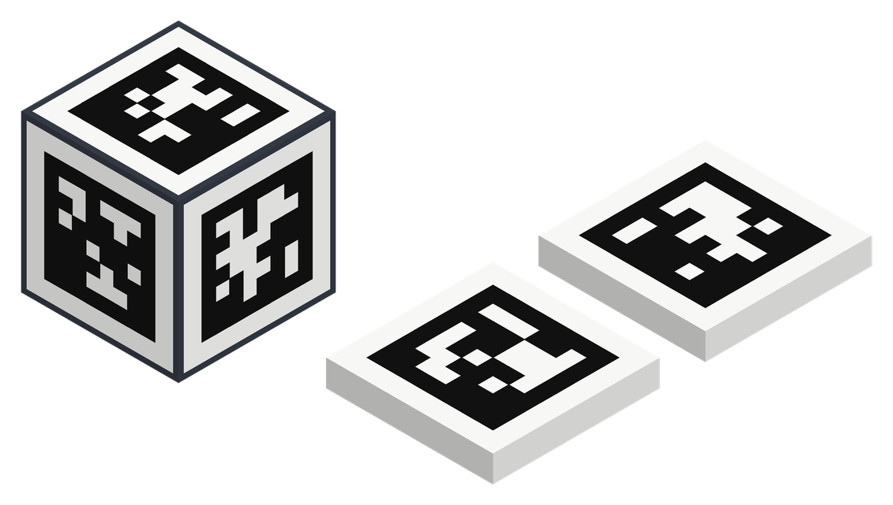

# April Cube 3DP

**A 3D-printable AprilTag cube, built from flat-printed two-colour tag tiles.**

[**Download tiles**](https://github.com/aaronhary/april-cube-3DP/releases/latest) · [**Cube**](cube/) · [**Onshape feature**](#-onshape-custom-feature)

---

## 💡 Why this project exists

<table>
<tr>
<td width="50%" valign="top">

### 🖨️ Flat printing: only 2 colour changes

Every tag tile prints **flat**, with the tag lying in the print plane. The colour changes only in the 0.4 mm inlay, which is two layers at 0.2 mm, so each tile needs about **two filament changes**. A cube with tags on its side walls would need a colour change on almost every layer.

</td>
<td width="50%" valign="top">

### 🧩 Maximum flexibility

Tags and cube are **separate parts**:
- Put any family and any ID on any face.
- Swap a tile without reprinting the cube.
- Reuse the cube.

Need something custom? The **Onshape feature** puts any tag on any flat face, at any size.

</td>
</tr>
</table>

> [!NOTE]
> The cube and the tag tile are based on designs by **[MADOS3D](https://www.mados3d.com/)**, released under CC0. Thank you for sharing them!

---

## 📦 Downloads

The tag tiles are available as zip files on the **[latest release](https://github.com/aaronhary/april-cube-3DP/releases/latest)**: one zip per family, one `.3mf` per tag ID.

| Family | IDs | Download |
|---|---|---|
| **tag36h11** ⭐ | 0 – 586 | [april-cube-3dp_tag36h11_tiles.zip](https://github.com/aaronhary/april-cube-3DP/releases/latest/download/april-cube-3dp_tag36h11_tiles.zip) |
| tag25h9 | 0 – 34 | [april-cube-3dp_tag25h9_tiles.zip](https://github.com/aaronhary/april-cube-3DP/releases/latest/download/april-cube-3dp_tag25h9_tiles.zip) |
| tag16h5 | 0 – 29 | [april-cube-3dp_tag16h5_tiles.zip](https://github.com/aaronhary/april-cube-3DP/releases/latest/download/april-cube-3dp_tag16h5_tiles.zip) |

**The cube** is in this repo: [`cube/cube.3mf`](cube/cube.3mf) for slicing, [`cube/cube.step`](cube/cube.step) for CAD.

Each tile file is **one object with two parts**:
- `white`: the tile with the pocket.
- `black`: the tag inlay.

The files are named like the official [apriltag-imgs](https://github.com/AprilRobotics/apriltag-imgs), e.g. `tag36h11_00042.3mf` for ID 42.

| | |
|---|---|
| Tile | 42.4 × 42.4 × 6.8 mm |
| Tag | 40 mm overall, inlaid 0.4 mm |
| Cube | 40 mm |

---

## 🖨️ Printing

1. Open a tile, e.g. `tag36h11_00000.3mf`, in your slicer: Bambu Studio, OrcaSlicer, PrusaSlicer, …
2. Assign **white** to the `white` part and **black** to the `black` part.
3. Print it as it lies, tag facing up, at **0.2 mm** layer height.
4. Print `cube.3mf` in any colour and mount six tiles.

> [!TIP]
> - Use a **different ID on every face**, and on every cube if you track several, so each face can be identified.
> - **Matte filament** reduces glare and improves detection.

---

## 🎯 Choosing a tag family

| Family | IDs | Cells | Tag size for your detector¹ | |
|---|---|---|---|---|
| **tag36h11** | 587 | 10 × 10 | **32.0 mm** | ⭐ Recommended: robust, supported everywhere (OpenCV, ROS, FRC) |
| tag25h9 | 35 | 9 × 9 | **31.1 mm** | Bigger cells, fewer IDs |
| tag16h5 | 30 | 8 × 8 | **30.0 mm** | Biggest cells, but many false detections |

¹ Pose estimation expects the edge length of the **black border square**, not the 40 mm overall size.

---

## 🛠️ Onshape custom feature

[`featurescript/AprilTag.fs`](featurescript/AprilTag.fs) adds an **AprilTag** feature to Onshape:
- Pick a flat face, a family and an ID.
- The feature cuts the tag into the part and fills the pocket with a separate black part.

It produces the same geometry as the tiles above, on any part you like.

**Install:**
1. Create a Feature Studio in your Onshape document.
2. Keep the two header lines Onshape generates.
3. Paste everything after the header lines from `AprilTag.fs`.

<b>Feature parameters</b>

| Input | Meaning |
|---|---|
| Face or plane | Planar part face (or a plane, for a sketch only). The tag reads correctly when viewed from outside. |
| Family | `tag36h11` (default), `tag25h9`, `tag16h5`, `tagStandard41h12` |
| Tag ID | 0 … (number of tags in the family − 1) |
| Tag size | Overall edge length including the white border: 4 cm gives a 4 × 4 cm tag |
| Center point | Optional vertex or mate connector; default is the face centre |
| Align to edge / Rotation | Orientation of the tag on the face |
| Draw outer boundary | Also outlines the white border (sketch-only use) |
| Corner chamfer | 0.2 mm by default. Where black cells touch only diagonally, the white corners are cut back, so the black stays one piece and both colours are valid solids |
| Inlay / Inlay depth | On by default, 0.4 mm. Cuts the black area into the part and creates the black part. Off: sketch only |

---

## 📄 Licenses

- **Cube and tile design:** [MADOS3D](https://www.mados3d.com/), CC0.
- **AprilTag code tables:** [AprilRobotics/apriltag](https://github.com/AprilRobotics/apriltag), © The Regents of the University of Michigan, BSD 2-Clause.

Maintainer notes

- [`tools/generate_families.py`](tools/generate_families.py) regenerates the tag tables in `AprilTag.fs` from the official `tagXXX.c` sources.
- [`tools/verify_tags.py`](tools/verify_tags.py) checks the tag rendering against the official tag images.
- [`tools/onshape_push.py`](tools/onshape_push.py) uploads the feature and its [icon](icon/AprilTag.svg) to a Feature Studio via the Onshape API, with keys in `.env` (see `.env.example`).
- [`tools/make_icon.py`](tools/make_icon.py) builds the feature icon.

